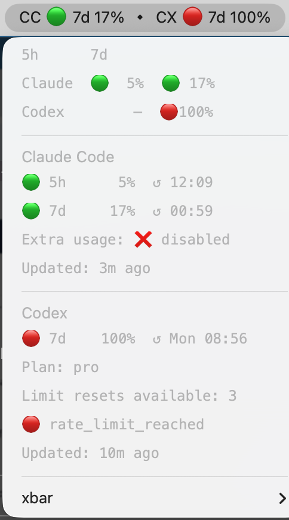

# xbar-claude-codex-usage

An [xbar](https://xbarapp.com) (or [SwiftBar](https://swiftbar.app)) menu-bar plugin that shows **Claude Code** and **OpenAI Codex** usage side by side, each with the rate-limit window closest to throttling.



The dropdown lists every window (5h / 7d / per-model), when each one resets, the Codex plan, credits, available limit resets, and how old the data is.

## Requirements

- macOS, Python 3 (no third-party packages)
- Claude Code, logged in with a Claude subscription (OAuth)
- Codex CLI (`npm i -g @openai/codex`), logged in; optional, since the Claude part works without it

## Install

```sh
curl -o ~/Library/Application\ Support/xbar/plugins/ai_usage.15m.py \
  https://raw.githubusercontent.com/stevermeister/xbar-claude-codex-usage/main/ai_usage.15m.py
chmod +x ~/Library/Application\ Support/xbar/plugins/ai_usage.15m.py
```

Then refresh xbar. The `15m` in the filename sets the refresh interval.

## How it works

| Tool | Source |
|---|---|
| Claude Code | `GET https://api.anthropic.com/api/oauth/usage` using the OAuth token Claude Code already stores (`~/.claude/.credentials.json` or the macOS Keychain item `Claude Code-credentials`) |
| Codex | Starts `codex app-server` and calls `account/rateLimits/read` over JSON-RPC on stdio |

Results are cached for ~13 minutes in `~/.claude_usage_cache.json` and `~/.codex_usage_cache.json`. If a fetch fails, the last cached value is shown, marked `⚠️ stale`.

**Credentials never leave your machine** except in requests to the provider's own API. The plugin stores no secrets.

## Caveats

Neither endpoint is a documented public API. Both are what the official clients use internally, so they can change or break without notice.

## Troubleshooting

- **Codex stuck on an old value / `⚠️ stale (timeout)`**: xbar runs plugins with a minimal `PATH`. The plugin adds `/usr/local/bin` and `/opt/homebrew/bin` so the npm `codex` shim can find `node`. If your `node` is somewhere else (nvm, volta), symlink it into one of those.
- **`⚠️ No Claude token`**: run `claude` once and log in.

## License

MIT
